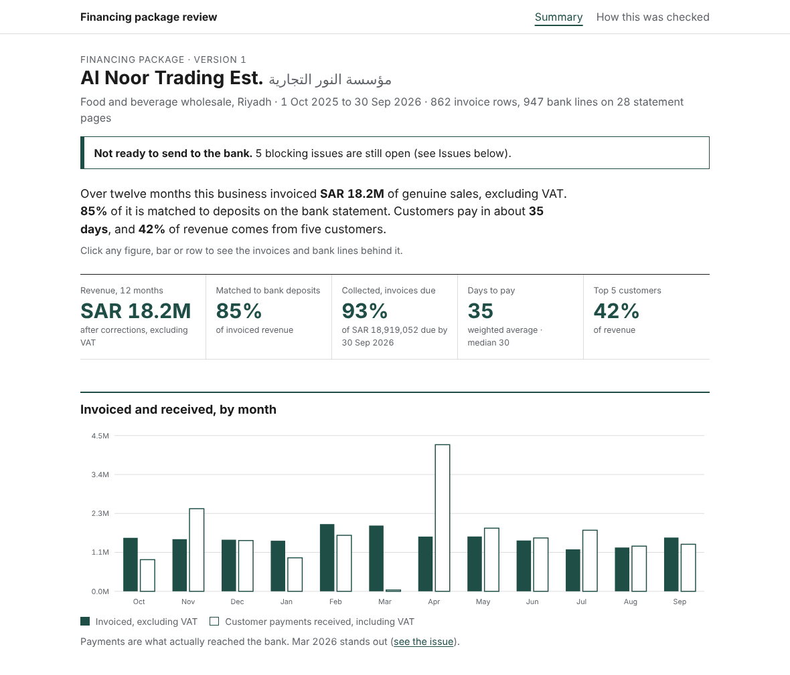
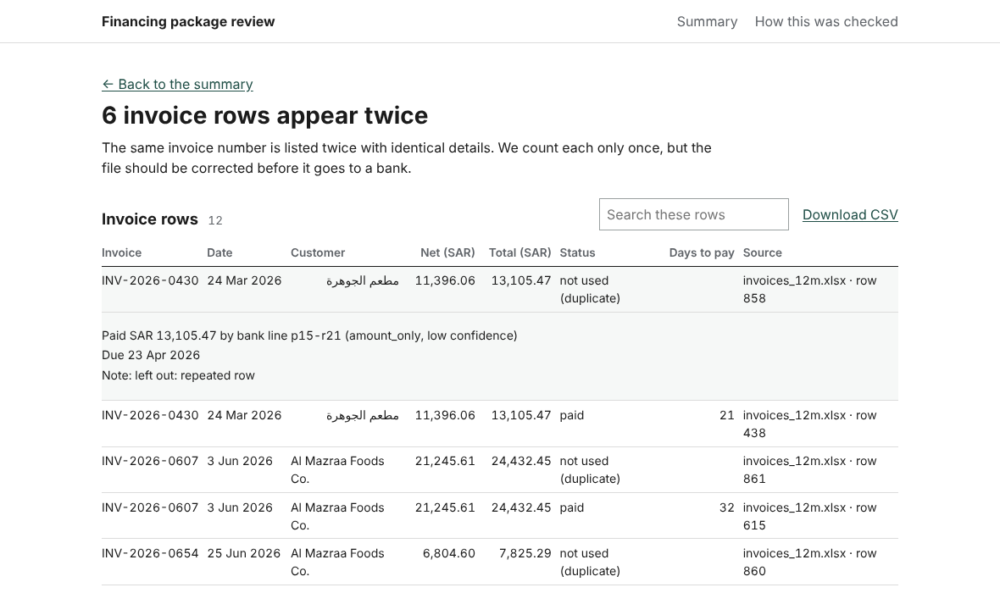
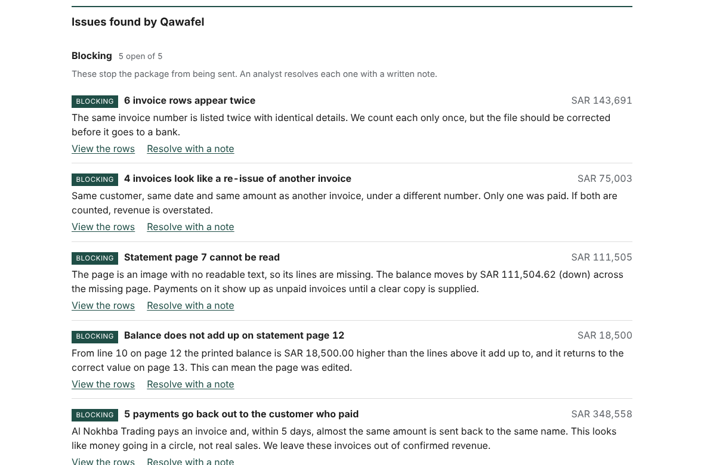

# Financing Package Review

A working prototype for the Qawafel Graduate Software Engineer assessment (Task 3). An SME wholesaler uploads 12 months of invoices (Excel) and bank statements (PDF). This prototype turns them into a package a bank's credit reviewer can judge in minutes, and shows what a person should check first.

**Live demo:** https://qawafel-usecase-bymeshari.onrender.com
The demo runs on free hosting, so the first load can take up to a minute.

All data is made up. The business (Al Noor Trading Est.), its customers and the bank are fictional.



## The question it answers

_Can this business repay a working-capital loan, and what in the files should a person check before the bank sees them?_

Invoices are claims. The bank statement is evidence. The prototype matches the two, and every figure on the screen opens to the invoices and bank lines behind it. It is plain arithmetic: no language model produces any number, so the same files always give the same result.

## Try it in two minutes

1. **Read the top of the page.** It says whether the package is ready to send. At the start it is not: five blocking issues are open.
2. **Click a figure, a bar or a customer.** You land on the exact invoices and bank lines behind it. Search, sort, download CSV, or click a row to see which deposit paid it and how sure the match is.
3. **Scroll to "Issues found by Qawafel".** Click _View the rows_ on any issue. On a blocking issue, click _Resolve with a note_ and the open count goes down.
4. **Open "How this was checked".** It shows how the matching and the issue checks scored against an answer key.

| Rows behind a figure                   | Issues                          |
| -------------------------------------- | ------------------------------- |
|  |  |

## What the sample business looks like

|                                                           |                |
| --------------------------------------------------------- | -------------- |
| Revenue from genuine customers (12 months, excluding VAT) | SAR 18.2M      |
| Share matched to bank deposits                            | 85%            |
| Invoices due that were collected                          | 93%            |
| Average days to pay                                       | 35 (median 30) |
| Top 5 customers                                           | 42% of revenue |
| Blocking issues at the start                              | 5              |

The decision this supports: a bank sees a healthy, concentrated business, and also sees exactly what is not yet clean enough to send (duplicate rows, a statement page that cannot be read, a balance that does not add up, money that goes out and straight back in).

## How it works

1. **Read the invoices.** Text dates, Arabic digits and amounts stored as text are repaired and noted. Nothing is thrown away.
2. **Read the statement.** Each line keeps its page and line number. A page with no readable text is reported, never guessed at.
3. **Merge customers.** The same customer in Arabic, in English or with "Co." is one customer, joined by VAT number.
4. **Match deposits to invoices,** from the most certain evidence to the least, and record how each match was made and how sure it is.
5. **Raise issues.** Blocking issues stop the package from counting as ready. Warnings and notes are shown to the reviewer.
6. **Work out the figures** from the matched rows only, so every number can be traced.

Matching order: invoice number in the bank text, same customer and amount, several invoices that add up, two deposits for one invoice, a slightly high deposit (low confidence), amount only (low confidence). Low-confidence matches are shown but marked for a person.

## How well it works on the sample data

| Check                                     | Result                                                                                                               |
| ----------------------------------------- | -------------------------------------------------------------------------------------------------------------------- |
| Matches made                              | 721, of which 99.6% are correct                                                                                      |
| Correct matches found (on readable pages) | 96.9%                                                                                                                |
| Weakest step                              | "Deposit a little too high": 7 of 10 correct, so it is marked low confidence                                         |
| Planted problems                          | Every kind was found. One of the four re-issued invoices was missed                                                  |
| Known side effect                         | The "unpaid over 90 days" check lists 38 invoices that are probably paid on the unreadable page. The summary says so |

These are scores on data I made, where the answer is known. Real files will be messier, and a real customer comes without an answer key.

## Run it on your computer

You need Python 3.10 or newer and Node 18 or newer.

```bash
# 1. Build the frontend
cd frontend
npm install
npm run build

# 2. Start the API (it also serves the built frontend)
cd ../backend
pip install -r requirements.txt
python -m uvicorn app.main:app --port 8000
```

Open http://localhost:8000. Interactive API docs are at http://localhost:8000/docs.

**With hot reload (two terminals):** run the API as above, then `cd frontend && npm run dev` and open http://localhost:5173. Vite forwards API calls to port 8000.

**Tests:** `cd backend && pytest` (9 tests: parsing, matching, issues, API).

**Docker:**

```bash
docker build -t package-review .
docker run -p 8000:8000 package-review
```

Settings, all optional: `DATA_DIR` (folder with the two input files, default `data/sample`), `STATIC_DIR` (built frontend, default `frontend/dist`), `PORT` (default 8000).

## Deploy

The Dockerfile builds the React app and serves it from the same FastAPI process, so it is one service on one URL. On Render: **New → Web Service**, connect this repo, choose **Docker**, pick the **Free** instance and create it. There is no database and no secret to set.

## API

The package is always called `demo`. The routes follow the read side of the spec in the report (section 2.2).

| Method and path                               | What it does                                                                                                   |
| --------------------------------------------- | -------------------------------------------------------------------------------------------------------------- |
| `GET /v1/package-versions/demo/summary`       | The one-page summary: figures, bridge, customers, issues                                                       |
| `GET /v1/package-versions/demo/figures/{key}` | The invoices and bank lines behind one figure, for example `revenue`, `revenue:2026-03`, `flag:F03`, `overdue` |
| `GET /v1/package-versions/demo/flags`         | All issues with severity and message                                                                           |
| `POST /v1/flags/{id}/resolve`                 | Resolve an issue. Body: `{"note": "...", "by": "..."}`. A note is required                                     |
| `POST /v1/flags/{id}/reopen`                  | Reopen a resolved issue                                                                                        |
| `GET /v1/package-versions/demo/method`        | Accuracy against the answer key                                                                                |
| `GET /api/health`                             | Counts of invoices and bank lines read                                                                         |

## Sample data

In `data/sample/`:

| File                          | What it is                                                                                                     |
| ----------------------------- | -------------------------------------------------------------------------------------------------------------- |
| `invoices_12m.xlsx`           | The wholesaler's invoice export, 1 Oct 2025 to 30 Sep 2026: 862 rows, 29 customers                             |
| `bank_statement_12m.pdf`      | The bank statement: 28 pages, Arabic and English, 947 readable lines                                           |
| `bank_transactions_truth.csv` | Machine-readable twin of the statement, used only to score the parser                                          |
| `ground_truth_matches.csv`    | Which deposit really pays which invoice, used only to score the matcher                                        |
| `answer_key_issues.csv`       | Every problem planted in the data, with its location                                                           |
| `generate_data.py`            | Makes all of the above. It is seeded, so it gives the same files every time: `python3 generate_data.py OUTDIR` |

The app reads only the xlsx and the pdf. The other files exist so the prototype can be graded.

### Assumptions behind the sample data

- A food and beverage wholesaler in Riyadh with about SAR 18M of sales a year before VAT, 29 customers, and a few large ones (the top five are about 42% of revenue).
- Sunday to Thursday working week. Mostly 30-day terms, with hotels and caterers on 45 or 60 days.
- Customers pay around their terms: one payment, several invoices at once, or two parts. A few pay late and a few never.
- 15% VAT on every invoice, and customers pay the VAT-inclusive amount.
- Bank text is messy like a real statement: sometimes the invoice number appears, often only the customer name, and sometimes a different spelling of it.
- Some customers appear in several spellings (Arabic, English, "Co.", extra spaces).
- Problems are planted on purpose so there is something to find: repeated rows, re-issued invoices, missing invoice numbers, due dates and VAT numbers, wrong VAT, credit notes that name no invoice, an unreadable scanned page, a page with an edited balance, money that goes out and straight back in, deposits that are not sales (loans, owner money, refunds), a month with almost no customer payments, and invoices unpaid for over 90 days.

### Assumptions in the prototype

- One business, one bank account, one currency (SAR), 12 months.
- Revenue is the net amount, excluding VAT. Customer payments include VAT, as the bank sees them.
- A missing due date means 30 days after the invoice date.
- A deposit can pay an invoice only on or after the invoice date, and only if the amount agrees within SAR 5.
- A credit note lowers what the customer is expected to pay for the invoice it names.
- Customers are merged by VAT number. A row without one is matched by name and flagged.

## What is not built

- File upload, hand-editing a match, freezing and sending a version to the bank, and the bank's answer. They are written as requirements in the report (Tasks 2 and 4).
- Reading the scanned page (OCR). The prototype reports the page as unreadable and shows how much money moved through it. Guessing would put invented numbers in front of a bank.
- Saving resolved issues. They are kept in memory and reset when the server restarts.
- Login and roles.

## Project layout

```
backend/app/    money, invoice and statement readers, matching, analysis, API
backend/tests/  pytest
frontend/src/   React app: summary, drill-down, method (no UI or chart libraries)
data/sample/    the sample data and its generator
docs/           screenshots used in this README
Dockerfile      builds the frontend and serves everything from one container
```

## AI tools used

- **Claude (Anthropic)** helped write and review the code, the tests, the sample-data generator and this README. I made the scope and design calls, ran the app, and checked its numbers against the answer key.
- **Copilot** produced a first set of sample data. I rejected it because of repeated transaction ids, payments bunched on a few days, and unreadable Arabic in the PDF. The data in this repo comes from the seeded generator, `data/sample/generate_data.py`.
